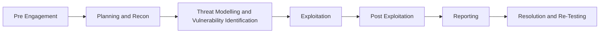

# Bug Bounty And Pentesting Methodology

> [!summary] Quick Recall
> **Phases:** Pre-Engagement → Planning & Recon → Threat Modelling & Vuln ID → Exploitation → Post Exploitation → Reporting → Resolution & Re-Testing
>
> **Report must define:** Objectives · Time · Target Audience · Classification · Distribution
> **Report process:** Information Collection → First Draft → Review & Finalization

---

## Phases of Penetration Testing

| # | Phase | What happens |
|---|---|---|
| 1 | **Pre Engagement** | Meeting with the client to have a crystal-clear understanding of all their needs and vision |
| 2 | **Planning and Recon** | Test plan generation and public information gathering through scanning |
| 3 | **Threat Modelling and Vulnerability Identification** | Model of all the security concerns and ranking vulnerability severity |
| 4 | **Exploitation** | Gaining access by breaching security of a system or finding a bug to exploit in the software |
| 5 | **Post Exploitation** | Determining the value of the assets compromised and further attack propagation |
| 6 | **Reporting** | Detailing the vulnerabilities found, stating impact and remedies |
| 7 | **Resolution and Re-Testing** | Resolving the issues and verifying the fixes |

---

## Penetration Testing Report Writing

### What the Report Must Define
- **Objectives** – Describes the overall purpose and benefits of pen testing.
- **Time** – Gives the accurate status of the system; indicates the validity of the report in the current scope.
- **Target Audience** – Such as information security manager, information technology manager, chief information security officer, and technical team.
- **Report Classification** – Classification needs to be done on the basis of the target organization's information classification policy, e.g., server IP addresses, application information, vulnerability, threats, etc.
- **Report Distribution** – Number of copies and report distribution should be mentioned in the scope of work.

### Report Writing Process
1. **Information Collection**
   - The pentester is required to mention all information collected in all stages of testing — additionally tools, scanning results, vulnerability assessments, details of findings, etc.
2. **Writing the First Draft**
   - Write the first draft in detail – mentioning everything, i.e., all activities, processes, and experiences.
3. **Review and Finalization**
   - After drafting, it has to be reviewed first by the drafter themself and then by seniors or colleagues who may have assisted.

---
**Prev:** [[2. Requirements Of A Pentester]] · **Next:** [[4. Bug Bounty Report Writing]]
